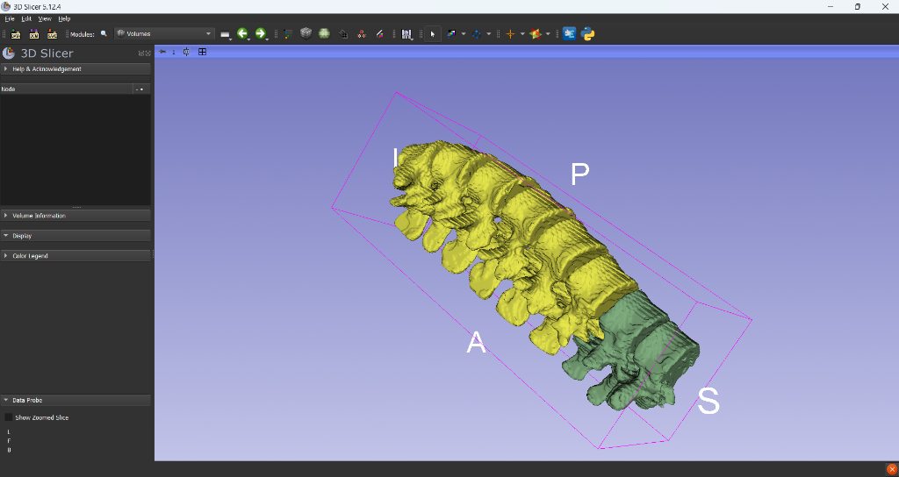
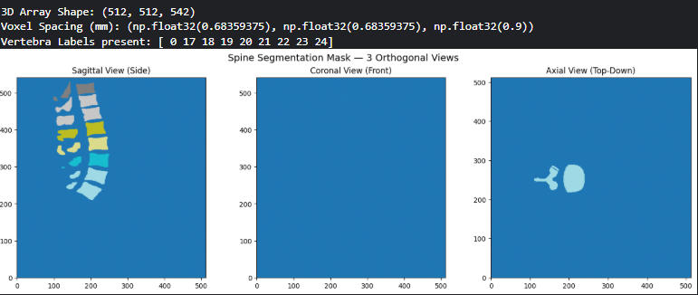
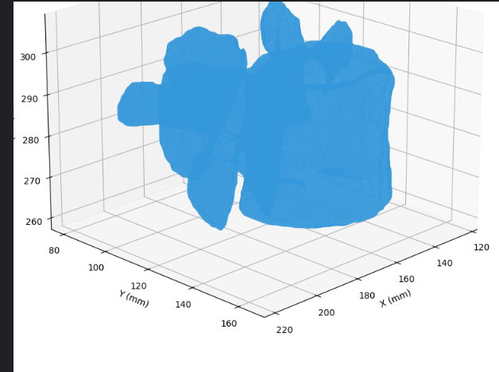

# BoneForge3D: 3D Bone Mesh Reconstruction from CT Segmentation Masks

An automated computational geometry pipeline that reconstructs watertight 3D triangle meshes (STL) from volumetric CT segmentation masks using Marching Cubes, Laplacian smoothing, and topological repair.

<div align="center">



*Reconstructed thoracolumbar spine (T10-L5) validated in 3D Slicer (v5.12.4), demonstrating surface continuity, anatomical curvature, and watertight geometry.*

</div>

---

## Overview

Medical deep learning models typically output volumetric voxel masks. However, surgical navigation systems, patient-specific implant CAD design, and additive manufacturing (3D printing) require continuous, watertight boundary representations.

BoneForge3D bridges this gap by converting multi-class vertebral CT segmentation masks into production-ready STL surface models. The pipeline accounts for physical voxel anisotropy, performs isosurface extraction via Marching Cubes, applies Laplacian smoothing to eliminate voxel discretization staircases, computes clinical morphometric properties (volume, surface area, compactness), and validates reconstructed meshes in 3D Slicer.

---

## Key Features

* **Anisotropic Scaling:** Scales coordinates by physical voxel zooms (0.68 x 0.68 x 0.90 mm) to preserve true anatomical aspect ratios.
* **Isosurface Extraction:** Implements Marching Cubes (Lorensen & Cline, 1987) to extract high-resolution triangular surfaces.
* **Topological Healing:** Applies Laplacian relaxation, eliminates degenerate and duplicate faces, and seals boundary holes to guarantee watertight 2-manifold meshes.
* **Computational Morphometry:** Quantifies physical volume (mm³) via Gauss's Divergence Theorem, surface area (mm²), and sphericity/compactness.
* **Clinical Software Compatibility:** Exports standard binary STL models validated directly in 3D Slicer for pre-operative surgical workflows.

---

## Visualizations

### Orthogonal Cross-Sections
Sagittal, Coronal, and Axial cross-sections of patient `sub-verse500` from the VerSe2020 dataset:



### Reconstructed Vertebra L3
Reconstructed Lumbar 3 vertebra showing the anterior load-bearing vertebral body, transverse and spinous processes, and central spinal canal:



---

## Pipeline Architecture

```text
+------------------------------+
|   Patient CT Scan (NIfTI)    |
+--------------+---------------+
               |
               v
+------------------------------+
| Volumetric Segmentation Mask |  <- Multi-class labels (T10 to L5)
+--------------+---------------+
               |
               v
+------------------------------+
| Physical Coordinate Spacing  |  <- Voxel zooms: 0.68 x 0.68 x 0.90 mm
+--------------+---------------+
               |
               v
+------------------------------+
| Marching Cubes Extraction    |  <- Discrete voxels to triangle mesh
+--------------+---------------+
               |
               v
+------------------------------+
| Topological Mesh Repair      |  <- Laplacian smoothing & hole filling
+--------------+---------------+
               |
        +------+------+
        |             |
        v             v
+--------------+ +------------------------------+
|  STL Export  | | Computational Morphometry    |
| (T10 to L5)  | | Volume (mm³), Area, Sphericity
+-------+------+ +--------------+---------------+
        |                       |
        v                       v
+--------------+ +------------------------------+
|  3D Slicer   | |    vertebra_geometry.csv     |
+--------------+ +------------------------------+
```

---

## Morphological Bone Analysis (Computed Metrics)

Metrics computed from VerSe2020 patient `sub-verse500`:

| Vertebra | Spinal Region | Vertices | Faces | Volume (mm³) | Surface Area (mm²) | Compactness | Watertight |
|:---|:---|:---:|:---:|:---:|:---:|:---:|:---:|
| **T10** | Lower Thoracic | 30,394 | 60,788 | 45,879.9 | 12,131.5 | 0.5109 | Yes |
| **T11** | Lower Thoracic | 30,747 | 61,498 | 48,673.4 | 12,337.5 | 0.5225 | Yes |
| **T12** | Thoracolumbar Junction | 34,135 | 68,274 | 57,100.5 | 13,624.3 | 0.5263 | Yes |
| **L1** | Upper Lumbar | 39,393 | 78,798 | 66,201.5 | 16,016.3 | 0.4941 | Yes |
| **L2** | Mid Lumbar | 41,835 | 83,674 | 70,434.8 | 17,159.7 | 0.4807 | Yes |
| **L3** | Mid Lumbar | 44,716 | 89,432 | 73,955.5 | 18,198.2 | 0.4682 | Yes |
| **L4** | Lower Lumbar | 42,878 | 85,756 | 72,177.2 | 16,927.1 | 0.4953 | Yes |
| **L5** | Lumbosacral Base | 51,125 | 102,286 | 83,091.1 | 19,046.0 | 0.4835 | Yes |

### Morphometric Findings:
1. **Load-Bearing Volume Gradient:** Bone volume scales from 45,880 mm³ (T10) to 83,091 mm³ (L5), representing an 81.1% increase in bone volume along the inferior spinal axis to accommodate cumulative body weight.
2. **Compactness Ratio:** Sphericity values cluster tightly between 0.46 and 0.53, reflecting the consistent ratio of the cylindrical vertebral body to the extended posterior articular processes.

---

## Project Structure

```text
BoneForge3D/
├── README.md                           # Technical documentation and results
├── requirements.txt                    # Pinned package dependencies
├── notebooks/
│   └── boneforge3d_reconstruction.ipynb # Full reconstruction workflow
├── src/
│   ├── __init__.py                     # Package interface
│   ├── mesh_extractor.py               # Marching Cubes and Laplacian smoothing
│   ├── geometry_analysis.py            # Morphometric metrics calculation
│   └── visualizer.py                   # Orthogonal and 3D rendering utilities
├── results/
│   ├── 3d_slicer_spine_reconstruction.png # 3D Slicer verification render
│   ├── segmentation_views.png          # Orthogonal cross-sections
│   ├── l3_reconstruction.png           # Isolated L3 3D mesh render
│   └── vertebra_geometry.csv           # Quantitative geometric metrics
└── sample_meshes/                      # Exported watertight STL models
```

---

## Installation and Usage

### 1. Installation
```bash
git clone https://github.com/username/BoneForge3D.git
cd BoneForge3D
pip install -r requirements.txt
```

### 2. Running via Python API
```python
import nibabel as nib
from src.mesh_extractor import extract_and_clean_mesh
from src.geometry_analysis import compute_mesh_metrics

# Load segmentation mask
seg_nib = nib.load("sub-verse500_dir-ax_seg-vert_msk.nii.gz")
seg_data = seg_nib.get_fdata()
spacing = seg_nib.header.get_zooms()

# Reconstruct vertebra L3 (Label 22)
mesh = extract_and_clean_mesh(
    seg_volume=seg_data,
    label_id=22,
    voxel_spacing=spacing,
    output_path="sample_meshes/vertebra_L3.stl"
)

# Compute geometric properties
metrics = compute_mesh_metrics(mesh, name="L3")
print(f"Volume: {metrics['volume_mm3']} mm³ | Watertight: {metrics['is_watertight']}")
```

### 3. Running the Jupyter Notebook
```bash
jupyter notebook notebooks/boneforge3d_reconstruction.ipynb
```

---

## Clinical Validation in 3D Slicer

The exported STL files can be loaded into 3D Slicer (v5.0+) or any CAD/3D-printing software:
1. Open 3D Slicer.
2. Click **File -> Add Data** and select the exported `.stl` files.
3. Verify surface manifold integrity, boundary smoothness, and relative intervertebral alignment.

---

## License
MIT License
